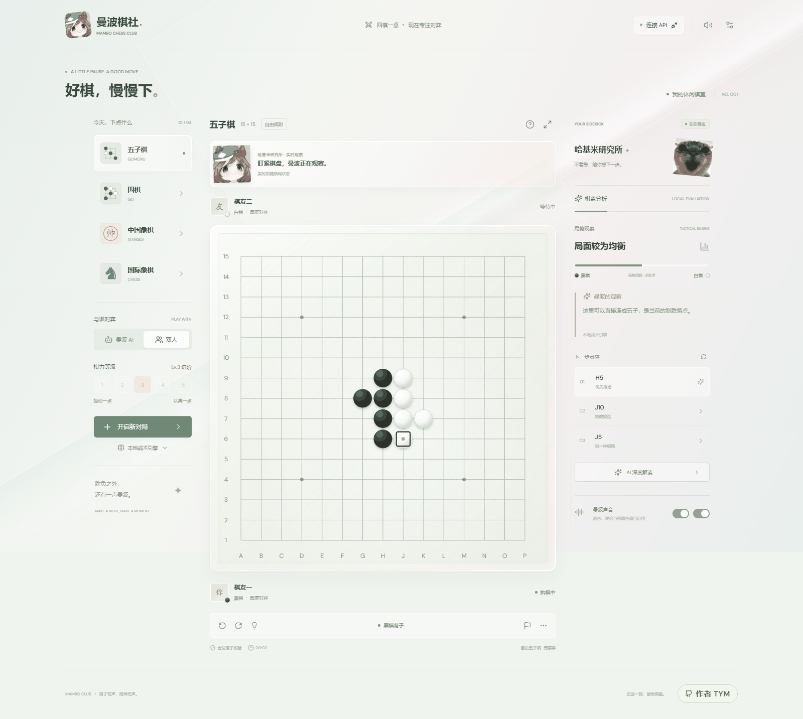
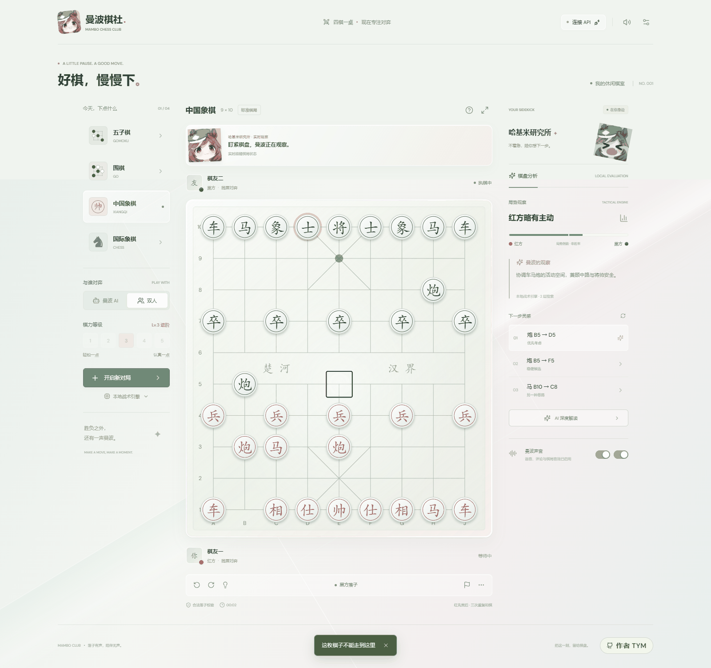
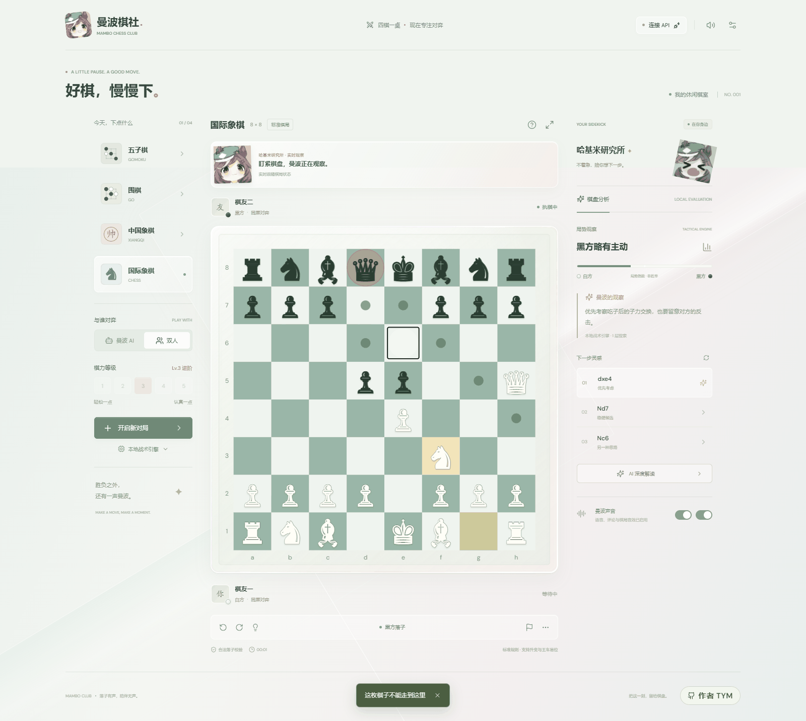
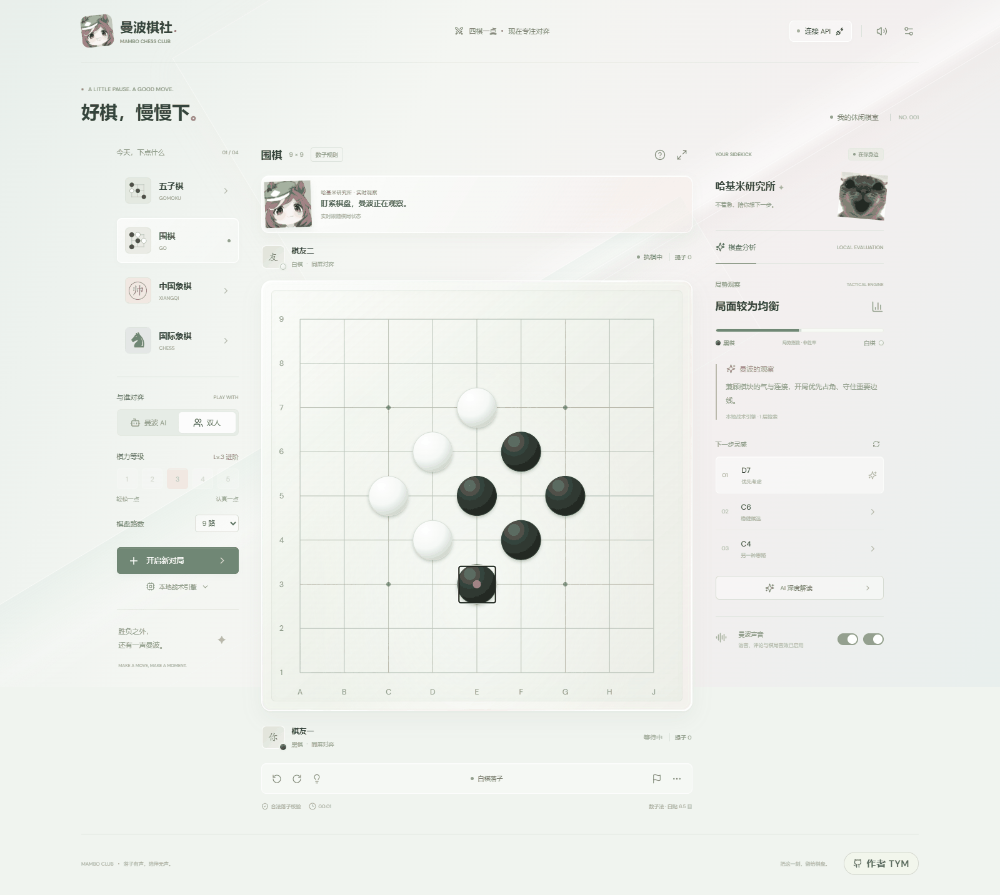
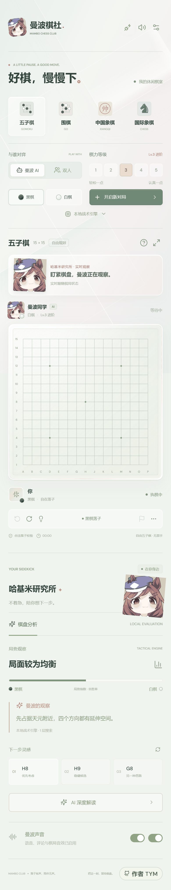
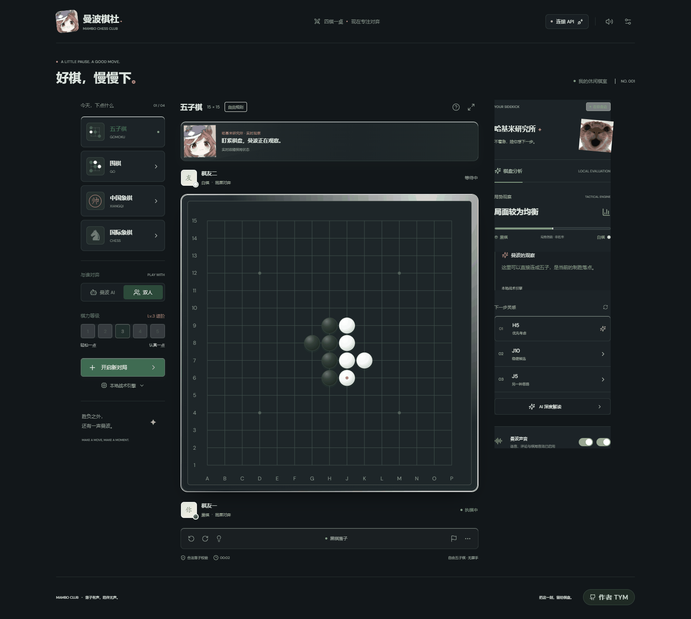
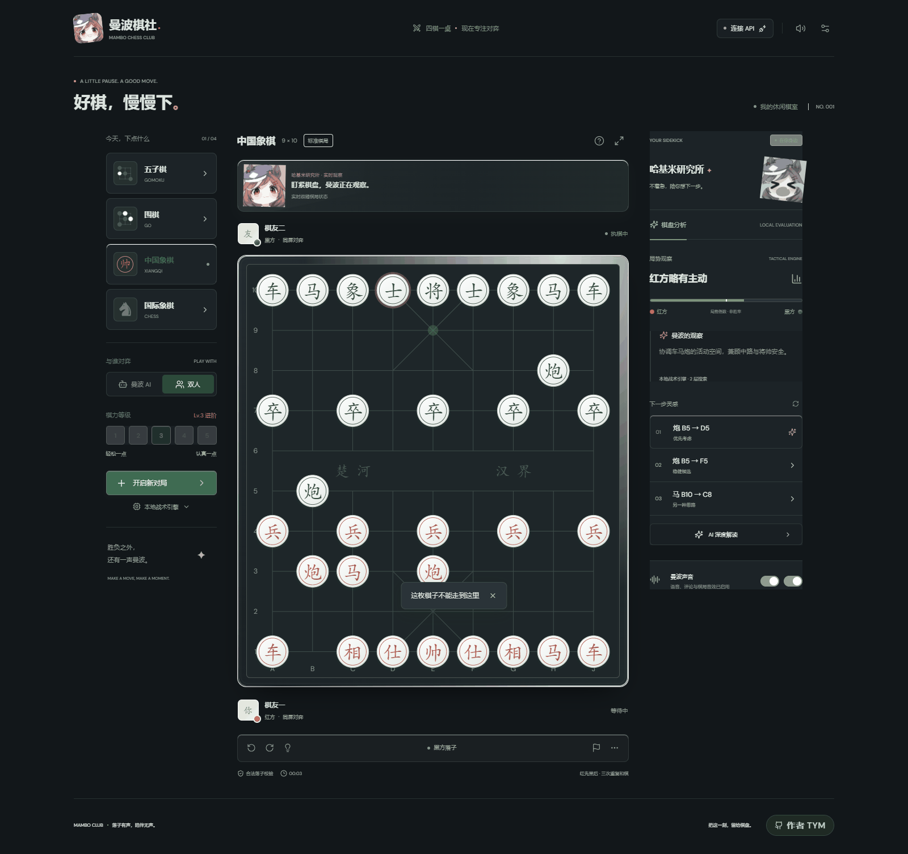

# Mambo Chess Club

**Four board games in one local web app** — Gomoku, Go, Xiangqi (Chinese chess) and
International Chess. Ready to play out of the box: no sign-up, no account, no internet required.

[](https://github.com/tymtym470/mambo-chess/actions/workflows/deploy-pages.yml)
[](./LICENSE)
[](https://nodejs.org/)

**🔗 Play online: <https://tymtym470.github.io/mambo-chess/>**
(The hosted build runs the local engine only — API play needs the backend, see *Hosted build limits* below.)

**中文** → [README.md](./README.md)



---

## What is this

A browser-based chess room where four games share one interface. By default it runs on a
**built-in local tactical engine** — no API key, no external service, just double-click and play.
To make it smarter, point it at any OpenAI-compatible Chat Completions provider: OpenAI,
DeepSeek, Google Gemini, Qwen, Moonshot/Kimi, SiliconFlow, OpenRouter, or a local Ollama model.

A cat named **Mambo** keeps you company: it reacts to the position, occasionally talks trash,
and is not gracious about winning.

## Quick start

### Option 1 — double-click (Windows)

Download the repo and run **`启动曼波棋社.exe`** in the project root. It will:

- reuse a running server if it is the same revision, and just open the page
- start the server hidden in the background if there is none, then open the page
- pick a free port if the default one is taken, **without killing the other process**
- shut the server down by itself once every page is closed — no stray background process

Stop it with **`停止曼波棋社.exe`** or `npm run stop`.

> Requires [Node.js](https://nodejs.org/) (≥ 20) to be installed.

### Option 2 — command line

```powershell
npm install
npm run dev        # dev server with hot reload
npm run build      # build static assets into dist/
npm start          # run the built version in production mode
```

## The four games

| Game | Rules |
|---|---|
| **Gomoku** | Free-style, no forbidden moves. Five or more in a row wins |
| **Go** | Area scoring, white gets 6.5 komi. Suicide and whole-board repetition (superko) are illegal |
| **Xiangqi** | Standard rules: horse-leg blocking, elephant-eye blocking, cannon screens, the palace, flying generals |
| **Chess** | Standard rules: castling, en passant, promotion, fifty-move rule |

Rules come from mature upstream libraries (`chess.js`, `elephantops`, `@sabaki/go-board`,
`gomoku-game`). This project only normalises coordinates and presents outcomes — it does not
reinvent rule engines.

## Features

### Playing

- **Local two-player** on one screen, taking turns
- **Mambo AI** with five levels (Beginner → Master) on the built-in local engine
- **Pick your side**, the board flips automatically
- **Undo**, **resign**, **pass** (Go), **flip board**, **focus mode**
- Optional **move numbers** for reviewing a game

### Coaching

- **Position analysis**: local heuristic evaluation with a live balance index and candidate moves
- **Deep read**: ask a model for a recommended move with reasoning (requires an API key)
- **Mambo's moods**: seven states — idle, thinking, capture, taunt, panic, win, draw
- **Sound and voice**, each switchable; background music loops only its first 30 seconds

### Appearance

- **Three-way theme**: Light / Dark / Follow system (Settings → Appearance).
  Dark mode text contrast is 14:1, above the 7:1 WCAG AAA requirement
- **Glass refraction**: a light effect that follows the cursor, can be turned off
- **Focus mode**: collapses both side panels, leaving only the board
- **Responsive**: three columns on desktop, stacks on narrow screens, usable down to 390px

### Reliability — where most of the effort went

**What the model says does not count. Only the rules count.**

- A move returned by a model **must** pass the local rules engine before it is played
- Out-of-range coordinates, negatives, plain prose, ambiguous multiple candidates and
  truncated output are **never executed**
- One automatic correction retry; if it still fails, the game **pauses and explains why** —
  it never force-plays an illegal move
- API keys stay in the server process or in browser memory, **never in browser storage**,
  and error diagnostics are redacted

<table>
<tr>
<td width="50%"><br><sub>Xiangqi</sub></td>
<td width="50%"><br><sub>International chess</sub></td>
</tr>
<tr>
<td width="50%"><br><sub>Go — scoring and captures</sub></td>
<td width="50%"><br><sub>Mobile layout</sub></td>
</tr>
<tr>
<td width="50%"><br><sub>Dark mode — Gomoku</sub></td>
<td width="50%"><br><sub>Dark mode — Xiangqi</sub></td>
</tr>
</table>

## Connecting a model API (optional)

Open **Connect API** in the top-right corner, pick a provider preset, enter the base URL and key,
click **Fetch models**, choose the exact model id your provider returns, then click
**Test move**. The configuration is only saved once the model actually returns a legal move.

Built-in presets: DeepSeek · OpenAI · Google Gemini · Qwen · Moonshot / Kimi ·
SiliconFlow · OpenRouter · local Ollama · custom OpenAI-compatible endpoint.

You can also configure it server-side: copy `.env.example` to `.env` (the key is never sent
to the browser).

```ini
PORT=5176
AI_BASE_URL=https://api.deepseek.com
AI_MODEL=
AI_API_KEY=
```

> When talking to `api.deepseek.com` directly, thinking is explicitly disabled
> (`thinking.type=disabled` for Chat Completions, `reasoning.effort=none` for Responses)
> so that reasoning cannot exhaust the output budget and truncate the move —
> **without renaming the model you selected**.

### Hosted build limits

GitHub Pages is static hosting with **no backend**, so the online build:

| Feature | Hosted | Local |
|---|---|---|
| All four games | ✅ | ✅ |
| Local tactical engine (5 levels) | ✅ | ✅ |
| Analysis / hints / undo / sound | ✅ | ✅ |
| **Model API play / deep read** | ❌ | ✅ |

Reason: API features rely on `server.mjs`, which holds the key and validates moves.
Static hosting has no such layer. This is an architectural trade-off, not a bug.

## Project layout

```
mambo-chess/
├── 启动曼波棋社.exe      one-click launcher (hidden window, embedded icon)
├── 停止曼波棋社.exe      stop the server
├── server.mjs            local server: static hosting + lease + API proxy
├── server/ai-api.mjs     model interface: dual protocol, correction retry, redaction
├── src/
│   ├── game.js           rules adapter (unified coordinates and outcomes for 4 games)
│   ├── App.jsx           main UI and state
│   ├── Board.jsx         board rendering
│   ├── ai.js             local tactical engine
│   ├── ai.worker.js      engine web worker
│   ├── audio.js          sound, voice, background music
│   └── storage.js        local save and validation
├── scripts/              launch, build launcher, screenshots, checks
├── tests/                unit tests and API integration tests
└── docs/screenshots/     README screenshots
```

## Development and tests

```powershell
npm test                 # unit tests (54)
npm run test:browser     # browser smoke: 4 games, AI play, scoring, settings
npm run test:models      # model interface tests
npm run test:api-browser # full API flow: discovery, trial, save, failure pause, retry
npm run test:lease       # server lease and auto-shutdown
npm run test:launcher    # launcher behaviour

npm run build:launcher   # rebuild 启动曼波棋社.exe (needs .NET Framework)
npm run screenshots      # regenerate docs/screenshots/
```

Pushing to `main` triggers [`.github/workflows/deploy-pages.yml`](.github/workflows/deploy-pages.yml),
which runs the tests, builds and publishes to GitHub Pages.

## Asset licensing

⚠️ **Images and audio in this repository were collected from the internet and are used
without the original authors' permission. They are NOT covered by the MIT license.**
Personal, local use is fine; **replace them with assets you have the rights to before
redistributing or using commercially.** Rights holders can open an issue and the files
will be removed promptly. See [ASSETS.md](./ASSETS.md).

## License

Source code is [MIT licensed](./LICENSE). Assets are excluded — see above.

## Author

**TYM** · GitHub [@tymtym470](https://github.com/tymtym470)

Four games, one table. Every move makes a sound.
